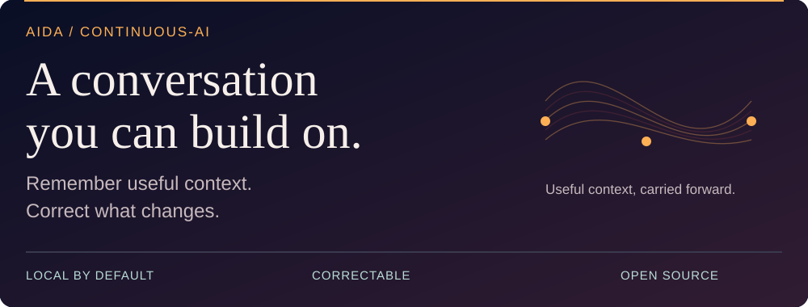
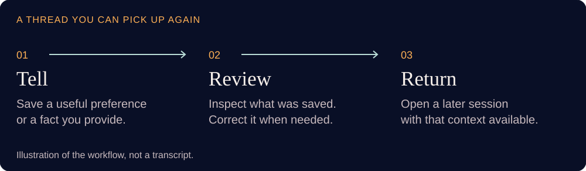
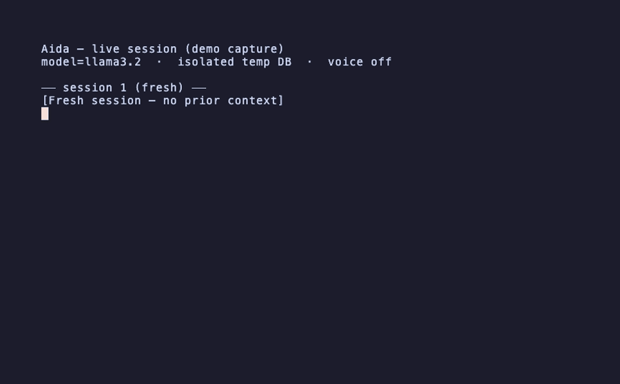
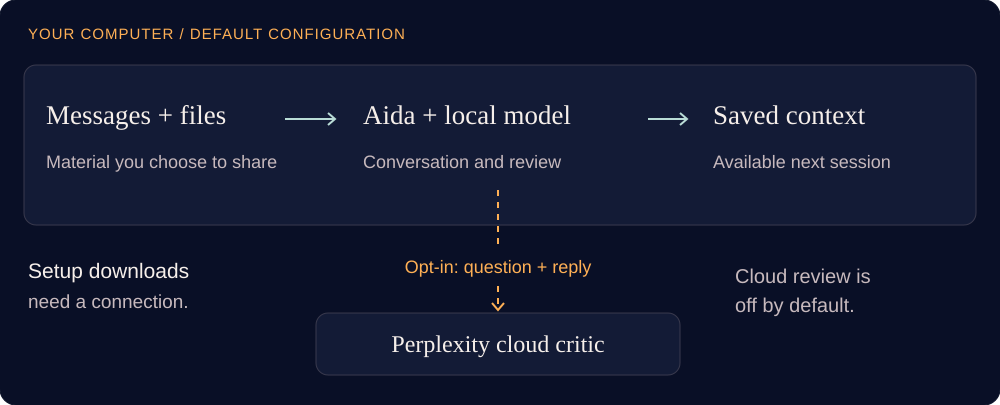
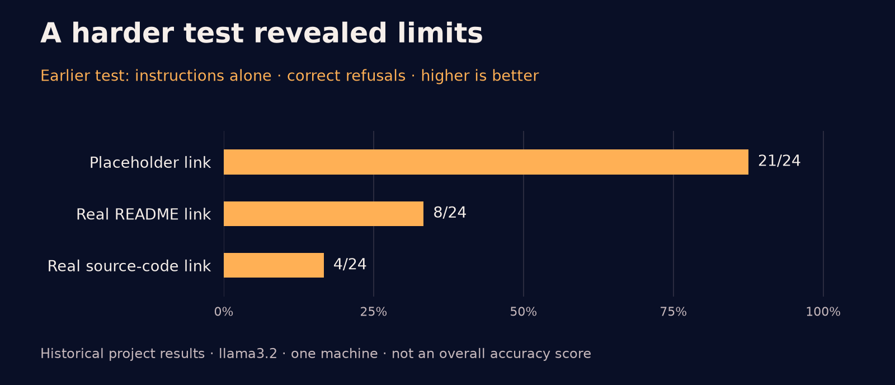

<picture>
  <source media="(max-width: 600px)" srcset="docs/readme-assets/hero-mobile.svg">
  
</picture>

# Aida · Continuous-AI

**A local AI assistant with memory you can inspect and correct.**

You should not have to explain the same preferences every time you start a conversation. Aida can keep useful context between sessions, accept corrections, and work with files you choose to share. It runs on your computer using a local language model—the software that generates replies.

**Aida** is the assistant. **Continuous-AI** is the software around the model that manages memory, checks, and interaction.

[See how it works](#a-conversation-that-can-continue) · [Try it](#try-aida) · [Privacy](#what-stays-on-your-computer) · [Evidence](#what-the-tests-show) · [Website](https://www.honest-aida.ai/)

**Current stage:** an experimental project operated through a terminal, the text-command app on your computer. It is for people willing to install and explore local AI, rather than a finished one-click chat service. **Aida can still give wrong or invented answers.** Its checks help manage that problem; they do not eliminate it.

## A conversation that can continue <a name="what-aida-does"></a><a name="architecture"></a>

<picture>
  <source media="(max-width: 600px)" srcset="docs/readme-assets/memory-story-mobile.svg">
  
</picture>

| What you want | What Aida provides |
| --- | --- |
| Less repetition | Saved facts and preferences that can carry into later sessions |
| A way to fix mistakes | Plain-language corrections and commands to inspect saved memory |
| Help with your own material | File attachments you request, including text, PDF, and DOCX |
| Visibility into a saved conclusion | A record that can include its basis, objections, limits, and what would reopen it |
| Control over where chat runs | Local model connections, with a local review step by default |

Saving context is different from retraining the model. The normal memory path stores information for later conversations. Optional model training is a separate advanced feature.

### See a real session <a name="mutualism--the-third-option"></a>

<details>
<summary><strong>Watch the existing recorded memory demo</strong></summary>

[](docs/assets/demo.gif)

This existing project recording shows the **teach → close → restore** memory flow using `llama3.2` and a temporary database. Open it at full size to read the terminal text. It is an earlier recording, not a fresh test of every current feature or a guarantee about reply accuracy. The [current recorder](scripts/record_demo.py) covers additional steps that this GIF does not show.

</details>

**The design idea is mutualism:** a working relationship shaped by useful contributions and correction. You supply context and judgment; Aida offers suggestions that remain open to revision. On some difficult turns it can ask for your input. This is a design goal, not evidence of consciousness or a measured guarantee that the partnership improves outcomes.

## Try Aida <a name="quickstart"></a><a name="platform-support"></a>

You will need **Python 3.11–3.13**, [Ollama](https://ollama.com/download), and a terminal. Ollama runs language models on your computer. macOS on Apple Silicon is the primary development platform; Linux and Windows are also supported, with shell scripts run through WSL or Git Bash on Windows.

**Before installing:** setup downloads dependencies and the configured model. The current default chat model is **`qwen3:30b-a3b`**, with **`gemma3:4b`** for background review. These need substantial memory and storage; speed depends on your hardware. For a smaller first run, use the [lightweight setup](docs/readme-guide.md#start-with-a-smaller-model) before running the default installer.

Install and start Ollama, then run these commands. The separate `ollama pull` line installs the default review model:

```bash
git clone https://github.com/StewAlexander-com/continuous-ai.git
cd continuous-ai
bash setup.sh
ollama pull gemma3:4b
bash run.sh
```

When chat opens, try these one line at a time:

```text
Remember that I prefer short explanations with one example.
Explain what a local AI model is.
:help
exit
```

Start again with `bash run.sh` to use saved context. Ask Aida about your preference and inspect what was stored with `bash run.sh forget` after exiting; without an index, that command lists persona facts. Saving a preference does not guarantee every reply will follow it.

<a name="commands"></a>

<details>
<summary><strong>A few useful commands</strong></summary>

| In the conversation | Purpose |
| --- | --- |
| `:help` | List available commands |
| `:setup` | Check model and file-reader status |
| `:read ~/notes.txt` | Attach a local file you choose |
| `:more` | Read the next section of a long attachment |
| `:why` | Inspect saved model conclusions, when available |
| `:theme dark` | Change the terminal appearance |
| `exit` | End the session |

To correct a saved fact, explain what is wrong and provide the replacement. If Aida offers a numbered choice, select the fact you mean; it does not ask the model to guess which saved fact to remove. More setup, memory, voice, and command details: [practical guide](docs/readme-guide.md).

</details>

## What stays on your computer <a name="configuration"></a>

<picture>
  <source media="(max-width: 600px)" srcset="docs/readme-assets/local-flow-mobile.svg">
  
</picture>

With the default local configuration, chat, memory, and the background answer review stay on your machine after setup. Model downloads, updates, and optional voice setup are separate network operations. Local storage still needs the same care as your other personal files and backups.

**An optional cloud setting changes this:** enabling the Perplexity critic sends the question and model reply to Perplexity for review. It is off by default. The local chat connection itself rejects model servers on other machines.

Aida does not browse websites. For a web page, paste the relevant text or save it locally and attach the file. A code check blocks recognized requests to read a URL; it is not a universal detector of every unsupported claim.

## What the tests show <a name="does-it-actually-work"></a><a name="why-its-different"></a>

The project publishes test tools and limitations alongside its claims. One useful finding: written instructions alone did not reliably stop a small model from inventing the contents of links it could not open.

<picture>
  <source media="(max-width: 600px)" srcset="docs/readme-assets/url-probe-mobile.png">
  
</picture>

Those findings led to a code check that refuses recognized URL-reading requests before asking the model. Its automated checks pass all **24 measured request combinations**. That verifies this particular boundary, not general truthfulness.

An earlier nine-case test reported **20% invented-answer failures without guard instructions and 0% with them** across five runs of `llama3.2`. The harder link tests above show why **0% on a small test does not mean “never wrong.”** Whether the model's saved-conclusion layer improves answer quality remains unproven. [Evidence, methods, and limits](docs/readme-evidence.md).

## Explore further <a name="recent"></a><a name="deep-dives"></a><a name="contributing"></a>

| If you want to… | Start here |
| --- | --- |
| Set up a smaller model or find a command | [Practical guide](docs/readme-guide.md) |
| Understand what is saved and how it changes | [Memory design](docs/design/memory-layering.md) · [Correction design](docs/corrigibility.md) |
| Inspect tests and their limits | [Evidence guide](docs/readme-evidence.md) |
| Follow development | [Releases](https://github.com/StewAlexander-com/continuous-ai/releases) |
| Report an issue or contribute | [Contributing](CONTRIBUTING.md) · [Issues](https://github.com/StewAlexander-com/continuous-ai/issues) |

## License and author <a name="license"></a>

[MIT License](LICENSE) · Copyright © 2026 Stewart Alexander.

Created by [Stewart Alexander](https://www.stewalexander.com/). Project website: [honest-aida.ai](https://www.honest-aida.ai/).
